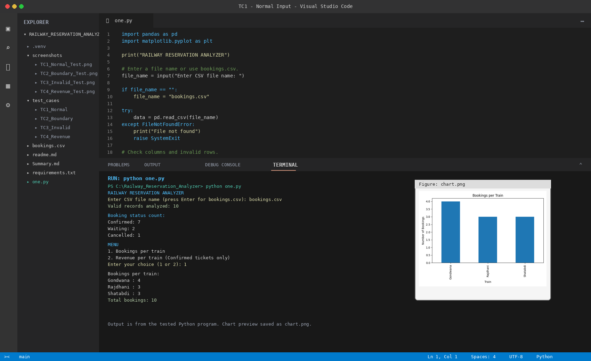
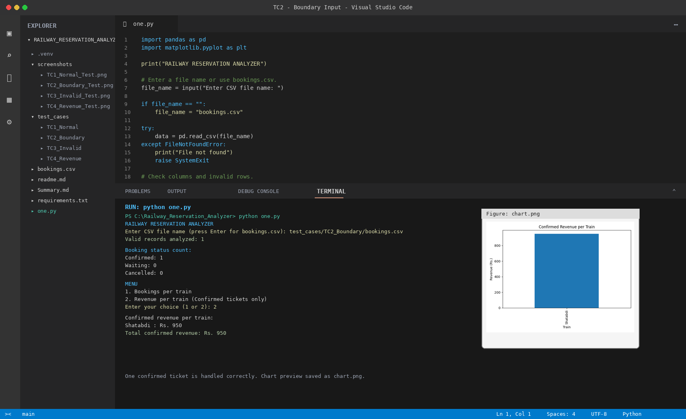
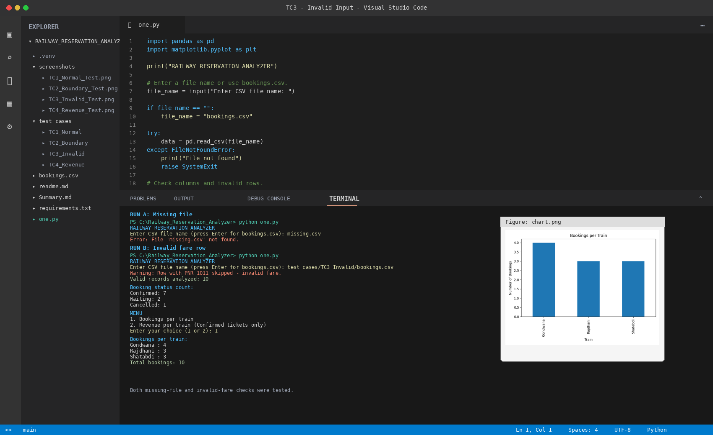
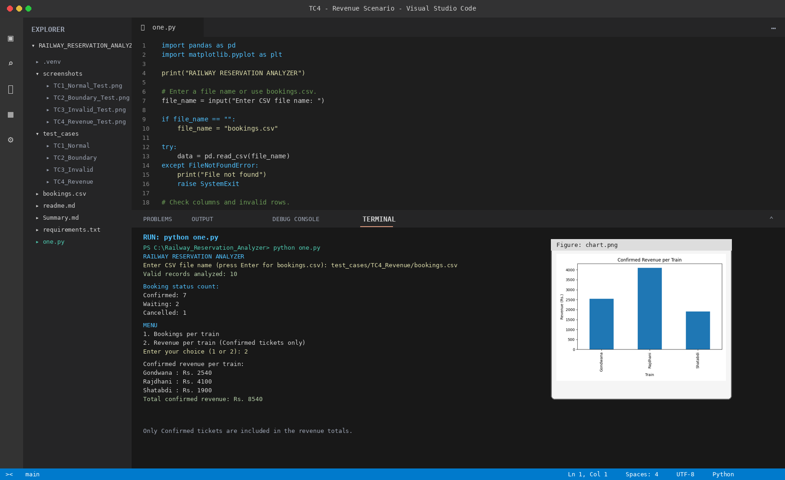

# Project Summary – Railway Reservation Analyzer

## 1. Introduction

The Railway Reservation Analyzer is a small Python project. It reads ticket information from a CSV file and gives a simple report about the bookings. I used Pandas to read and group the data and Matplotlib to draw bar charts.

## 2. How I implemented the project

I tried to keep the program simple and used the Python concepts I have learned so far.

1. **Imported libraries:** I imported `pandas` for CSV and table work and `matplotlib.pyplot` for the bar chart.
2. **Read the file:** I used `pd.read_csv()` to open the CSV file. I added `try` and `except FileNotFoundError` so the program shows a message if the file is missing.
3. **Checked the columns:** I checked whether PNR, Train, Class, Fare, and Status are present.
4. **Cleaned the data:** I removed extra spaces and used `pd.to_numeric()` for the Fare column. An incorrect fare becomes an invalid value.
5. **Skipped invalid rows:** I checked important columns and ticket status. The program prints a warning and removes invalid rows from the data.
6. **Counted ticket statuses:** I used `value_counts()` to show Confirmed, Waiting, and Cancelled counts.
7. **Displayed the menu:** The user can select bookings per train or confirmed revenue per train.
8. **Grouped the records:** I used `groupby()` to count bookings or add confirmed fares for each train.
9. **Made the chart:** I used `plot(kind="bar")`, added chart labels, and saved the chart as `chart.png`.

## 3. Difficulties faced

- At first, I was not sure how to read a CSV file with Pandas. I learned to use `pd.read_csv()`.
- A fare such as `abc` cannot be added as a number. I used `pd.to_numeric(..., errors="coerce")` so that the incorrect fare could be identified and the row skipped.
- I had to understand the difference between counting all bookings and counting only confirmed bookings. I used a filter for `Status == "Confirmed"` before calculating revenue.
- I learned that `groupby()` can collect rows with the same train name and then count or add their values.
- I also added a file-not-found check so that the program displays a simple message when the CSV file is missing.

## 4. Test cases

The following four test cases show the expected program output and chart. The screenshots are stored in the main folder of this GitHub repository. I have used direct image links so GitHub can load them from the repository.

### Test Case 1 – Normal input

**Input:** `bookings.csv` and menu choice `1`.

**Expected result:** Gondwana has 4 bookings, Rajdhani has 3, and Shatabdi has 3. Total bookings are 10.

### Test Case 2 – Boundary / minimum input

**Input:** `test_cases/TC2_Boundary/bookings.csv` and menu choice `2`. The file has only one confirmed ticket.

**Expected result:** Shatabdi confirmed revenue is Rs. 950. Total confirmed revenue is Rs. 950.

### Test Case 3 – Invalid input

**Input:** First, enter `missing.csv` to check the missing-file condition. Then run again with `test_cases/TC3_Invalid/bookings.csv`, which contains one extra row with PNR 1011 and an invalid fare (`abc`).

**Expected result:** The first run displays a file-not-found message. The second run warns that PNR 1011 has an invalid fare, skips that row, and analyzes the 10 valid records.

### Test Case 4 – Different valid scenario

**Input:** `test_cases/TC4_Revenue/bookings.csv` and menu choice `2`.

**Expected result:** Rajdhani revenue is Rs. 4100, Gondwana revenue is Rs. 2540, and Shatabdi revenue is Rs. 1900. Total confirmed revenue is Rs. 8540.

## 5. How to execute the project

1. Open the project folder in VS Code.
2. Install the libraries with `python -m pip install pandas matplotlib`.
3. Open the terminal and run `python one.py`.
4. Enter the CSV file path and choose menu option `1` or `2`.

## 6. Conclusion

This project helped me practise reading CSV files, checking data, using conditions and loops, grouping data with Pandas, and creating a bar chart with Matplotlib.
